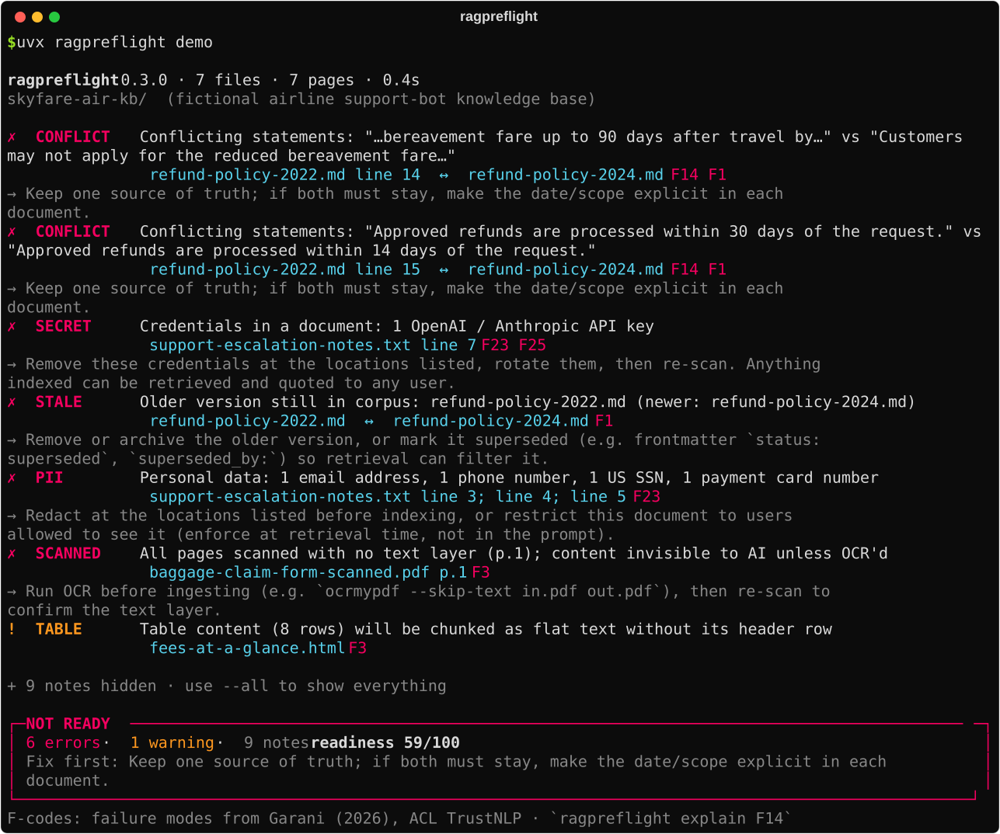

# ragpreflight

**Lint your knowledge before your agent reads it.**

[](https://pypi.org/project/ragpreflight/)
[](https://github.com/anusky95/ragpreflight/actions/workflows/ci.yml)
[](LICENSE)
[](https://aclanthology.org/2026.trustnlp-main.27/)

Most "hallucinations" in RAG and agent systems start before the model ever runs: an old policy still sits next to the new one, two versions disagree, a scanned PDF has no text, a fee table turns into run-on numbers, a chunk boundary cuts "must be requested **before travel**" away from the rule it qualifies.

`ragpreflight` finds those problems in your documents **before** you embed them, compile them into an LLM wiki, or hand them to an agent. One command. Offline. No API keys. No vector database.

```bash
uvx ragpreflight demo          # see it catch a real-world failure in 2 seconds
uvx ragpreflight ./docs        # run it on your own folder
```

<p align="center"></p>

> In 2024 an airline was ordered to pay a customer after its chatbot described a refund rule the airline's actual policy didn't allow. The demo reproduces that shape: a 2022 refund policy left next to the 2024 one, with opposite rules. ragpreflight flags the conflict, the stale file, and the chunk split that would hide the correct rule.

## What it checks

| Check | What it catches | Failure mode |
|---|---|---|
| **Version conflicts** | Two versions of a document that disagree: `90 days` vs `14 days`, `after travel` vs `before travel` | F14 · F1 |
| **Stale versions & duplicates** | Older copies still in the corpus; exact duplicates | F1 |
| **Period twins** | `10-K 2022` / `10-K 2023` style files that retrieval will confuse | F1 · F16 |
| **Scanned & empty files** | Pages with no text layer — invisible to your AI | F2 · F3 |
| **Garbled text & tables** | Mojibake, `(cid:12)` junk, tables that extract as run-on numbers | F3 · F4 |
| **Chunk splits** | Qualifiers (`not`, `unless`, `before`) cut away from their claim; orphaned headings; tables split across chunks | F7 |
| **PII & secrets** | Emails, phones, SSNs, card numbers, API keys, private keys — anything a user could get the bot to quote | F23 · F25 |
| **Missing metadata** | No date, no owner, placeholder titles — answers can't be dated or traced | F21 |

Formats: PDF, DOCX, Markdown (with YAML frontmatter — LLM-wiki and [OKF](https://github.com/GoogleCloudPlatform/knowledge-catalog) friendly), TXT, HTML.

Every finding links to a failure mode (F1–F33) from *A Systematic Taxonomy of Failure Modes in Retrieval-Augmented Generation Systems* (Garani, ACL TrustNLP 2026). `ragpreflight coverage` shows which of the 33 are checked before ingestion and which belong to eval or tracing tools instead.

## Use it everywhere you ingest

**CLI**

```bash
pip install ragpreflight
ragpreflight ./kb                       # terminal report; exit 1 if there are errors
ragpreflight ./kb --out report.html     # plus a shareable HTML report
ragpreflight ./kb --format json         # for scripts and agents
ragpreflight ./kb --fail-on warn        # stricter CI gate
```

**Python** — gate your ingestion job

```python
from ragpreflight import scan

report = scan("./kb")
if report.verdict == "NOT READY":
    for f in report.findings:
        print(f.severity.value, f.title, f.path, f.fix)
    raise SystemExit(1)
```

**GitHub Action** — every PR that touches your knowledge base

```yaml
- uses: anusky95/ragpreflight@v0.3.0
  with:
    path: docs/
    fail-on: error
```

The report lands in the job summary.

**pre-commit**

```yaml
- repo: https://github.com/anusky95/ragpreflight
  rev: v0.3.0
  hooks:
    - id: ragpreflight
```

**Claude Code, Cursor and other agents** — copy [`skills/ragpreflight`](skills/ragpreflight/SKILL.md) into your agent's skills folder. Your coding agent will lint documents before it builds an index, and check sources first when you report a wrong answer.

## Design choices

- **Precision over recall.** A linter that cries wolf gets uninstalled. Checks are conservative and every finding carries its evidence.
- **Deterministic and offline.** Same input, same output, in CI, on a laptop, on an air-gapped server.
- **Architecture-neutral.** Vector RAG, agentic search, LLM wikis, long-context stuffing — they all read the same source files.
- **Not an eval tool.** Ragas, DeepEval and friends score answers after the fact. ragpreflight scores the documents before. Use both.

## Commands

| Command | |
|---|---|
| `ragpreflight PATH` | Scan a folder or file (same as `ragpreflight scan PATH`) |
| `ragpreflight view FILE.pdf` | See one PDF with every problem highlighted on its pages (opens in your browser) |
| `ragpreflight demo` | Scan the bundled demo knowledge base (`--chat`: ask a support bot 5 questions before and after) |
| `ragpreflight chunks export.jsonl` | Lint the real chunks exported from your vector store: cut conditions, headers lost from tables, oversize chunks, duplicates, PII already in the index |
| `ragpreflight ab ./docs -q questions.json` | Ask the same questions before and after ragpreflight's fixes; side-by-side page with retrieved passages and Claude's answers |
| `ragpreflight explain F14` | Explain a failure mode |
| `ragpreflight coverage` | What is checked before ingestion, and what isn't |

Options: `--format text|json|md|html`, `--out FILE`, `--fail-on error|warn|never`, `--only versions,pii`, `--skip chunking`, `--all`.

Chunk checks simulate a splitter. Match yours with `--chunker`: `fixed-512` (default), `openai` (800 tokens, 400 overlap), `langchain` (1000 chars, 200 overlap), `llamaindex` (1024 tokens, 200 overlap), or `tokens:SIZE[:OVERLAP]`.

The HTML report (`--out report.html`) groups findings by who fixes them. It shows a network of document versions and a page heatmap. Every finding links to its source file at the exact page, with line numbers and masked evidence.

Exit codes: `0` clean (at the chosen level) · `1` findings at `--fail-on` level · `2` bad path or nothing to scan.

## Citation

```bibtex
@inproceedings{garani2026taxonomy,
  title     = {A Systematic Taxonomy of Failure Modes in Retrieval-Augmented Generation Systems},
  author    = {Garani, Anupama},
  booktitle = {Proceedings of the TrustNLP Workshop at ACL 2026},
  year      = {2026},
  url       = {https://aclanthology.org/2026.trustnlp-main.27/}
}
```

MIT licensed. Issues and check ideas welcome — especially real documents that fooled it.
